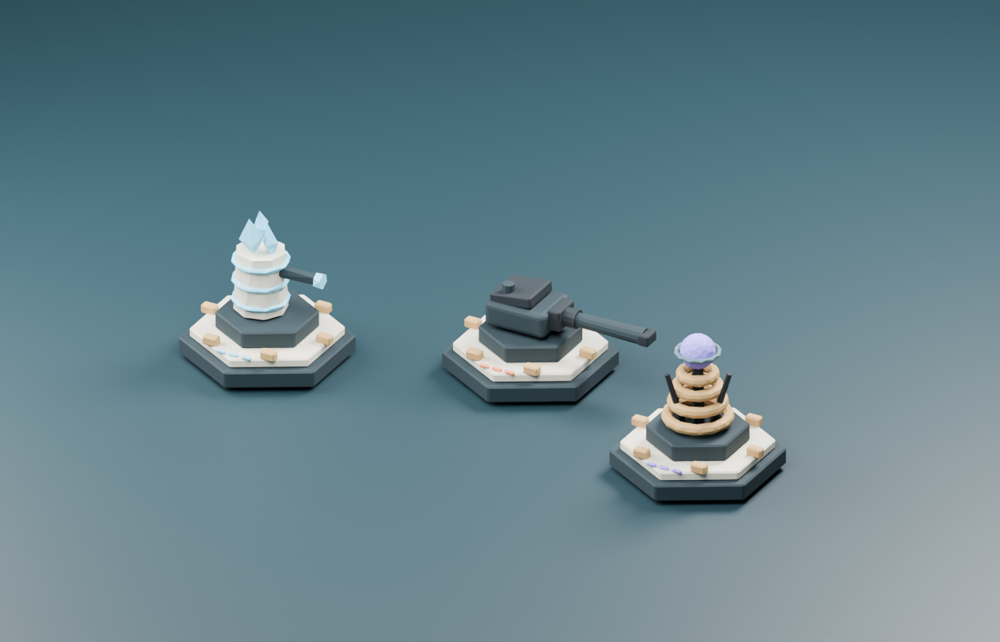

# Bastorynn — Citadelles V4

Refonte de l’interface et de la bibliothèque 3D, avec assets Blender intégrés et règles V3.2 conservées. [Détails et validation](REFONTE_V4.md) · [Maquettes Figma](https://www.figma.com/design/sOMbAInE8ss4scp8J74sgQ).



# Bastorynn — version tactique 3.2

La V3.2 rééquilibre les défenses lointaines et ajoute un guide de composition dans l’Arsenal : type de dégâts, effets, rôles manquants, filtres et schéma des cinq réactions, avec vues PvE et PvP. Le Courroux et les autres satellites tirent entre 10 et 40 m, infligent 15 % de dégâts en moins et ne cumulent plus plusieurs frappes d’une même salve sur une cible.

Les grosses armées profitent de recherches de cibles partagées, de requêtes spatiales pour les zones et d’un rendu qui adapte les effets au nombre de troupes. Un défaut qui laissait se multiplier les nuages corrosifs est corrigé : six nuages de réaction actifs maximum par plateau. Les règles, mesures et limites sont détaillées dans `verification/V32_EQUILIBRAGE.txt`.

La V3.1 intègre les corrections utiles de l'archive `Bastorynn-corrige.zip` dans la V3 tactique. Elle corrige les requêtes interrompues qui bloquaient les comptes, les départs pendant la préparation PvP, la reprise de campagne après départ de l'hôte et le nettoyage des salons. Elle ajoute aussi des protections HTTP et vérifie les decks par rapport à la sauvegarde en ligne. Le détail des adaptations et des validations figure dans `verification/V31_REVUE.txt`.

Cette livraison enrichit le jeu fourni dans `Bastorynn-main.zip`. Elle contient le jeu compilé, ses sources, le serveur et les contrôles reproductibles. Le déploiement Render doit être vérifié séparément de la publication du code sur GitHub.

## Essayer le jeu

Extraire **tout** le ZIP, puis ouvrir `index.html` dans Chrome ou Edge. Choisir **Jouer l’initiation** : six vagues, un deck fourni, aucune inscription. Les fichiers `assets/` doivent rester à côté du HTML. L’initiation ne dépense pas la collection et ne donne pas de récompenses de campagne.

Pour jouer entre appareils, installer Node.js 20 ou plus récent, puis exécuter dans ce dossier :

```sh
npm install
npm start
```

Ouvrir l’adresse affichée par le serveur. Le lanceur Windows `OUVRIR_MULTIJOUER.bat` convient également au stockage local. Un compte sur ce serveur est nécessaire pour les salons réseau. Le mode fichier seul ne fournit pas les comptes ni le multijoueur réseau.

## Nouveautés effectivement intégrées

- Accueil Bastorynn et initiation guidée, avec deck commun et six vagues.
- Cinq réactions : fracture, choc thermique, conductivité, vapeur corrosive et rupture de bouclier. Le vent accélère aussi la disparition des fumées. Plafonds, délai de réaction et absence de réactions récursives.
- Météo déterministe par biome : temps clair, pluie, brouillard, orage, neige et vent selon la carte. Phases de 120 secondes, préavis de 12 secondes, zones de foudre annoncées 3 secondes avant l’impact.
- Spécialisation gratuite au niveau 2, à choix unique par tour. Deux choix selon la famille, avec compromis ; effets réduits en PvP.
- Trois ordres disponibles tous les trois niveaux de vague terminés en PvE/coop : cadence, portée ou recharge des pouvoirs, pour deux vagues. Un choix commun à la citadelle, sans blocage si le joueur ignore l’offre.
- Conseiller tactique : météo, menaces, contre-stratégies, combinaisons, journal court et conseil de défaite.
- Canon, Cryo et Tesla plus distincts ; blindages et silhouette spécifiques pour le Garde d’élite, le Béhémoth et le Char de rupture. Les animations de base sont conservées.
- Sons chargés à la demande, compression HTTP et ETag, ciblage spatial et limitation des mises à jour de l’aide tactique.
- Règles communes compilées pour le navigateur et le serveur. Les spécialisations sont validées par propriétaire et transmises dans les instantanés réseau.

Le catalogue existant, les cartes, la campagne, les enchères et les formats multijoueurs restent dans le projet. La collection et son économie historiques n'ont pas été rééquilibrées intégralement.

## Sources et reconstruction

- `src/client.js` : source principale du client et blocs de simulation partagés.
- `src/tactics.js` : réactions, météo, spécialisations, ordres et index spatial.
- `src/defense-guide.js` : profils de défense dérivés des statistiques, analyse du deck et schéma des réactions.
- `src/tactical-config.json` : temporisations et plafonds des nouvelles règles.
- `src/tactical-ui.js`, `src/tactical.css` : interface tactique et initiation.
- `src/renderer.js` : moteur de rendu d’origine ; les modèles sont enrichis dans la couche procédurale de `src/client.js`.
- `src/audio-bank.js` : bibliothèque sonore d’origine différée.
- `scripts/build.cjs` : production de `simulation.js`, des HTML et des fragments des deux dossiers `assets`.

```sh
npm run build
npm test
npm run audit:maps
node scripts/training-check.cjs
npm run benchmark
node scripts/stress-simulation.cjs
node scripts/stress-pvp.cjs
```

Ne pas modifier les fichiers compilés à la main. Après un changement dans `src/`, reconstruire les deux clients et la simulation ensemble. Aucune dépendance supplémentaire n'est requise pour le build ou les tests du moteur. Les tests réseau démarrent un serveur local avec des comptes fictifs et un dossier temporaire, jamais avec la base configurée pour la production.

Le test facultatif `node scripts/browser-smoke.cjs` nécessite Playwright et Chrome installé. `PLAYWRIGHT_MODULE` permet de fournir le chemin d'un Playwright déjà disponible. Il vérifie trois formats d’écran et le mode fichier ; il écrit ses captures dans `verification/screenshots/`. Il utilise le port local 8790 et un stockage de test dans le dossier temporaire du système.

## Validation et limites

Les résultats propres à la V3.2 sont dans `verification/v32-*`, `verification/stress-browser-*.json` et `verification/V32_EQUILIBRAGE.txt`. Les rapports `v31-*`, `V31_REVUE.txt`, `v3-*` et `V3_BILAN.txt` décrivent les livraisons précédentes. Les scripts `check-deck-guide.cjs` et `stress-browser.cjs` utilisent le même Playwright/Chrome que le test navigateur principal.

Les tests d’écran sont réalisés dans Chrome desktop avec des tailles de fenêtre et des entrées tactiles émulées. Ils ne prouvent pas les performances sur un téléphone physique. Les benchmarks mesurent le moteur Node.js, sans rendu 3D ni coût réseau. L’audit des cartes vérifie la continuité, les limites, les possibilités de pose initiale et les longueurs symétriques en PvP ; il ne prouve pas que chaque îlot est utile ni que tous les matchs sont équilibrés.

La refonte de l’ensemble des modèles et menus, les convois et événements secondaires, les décors météo animés, l’optimisation GPU de toutes les unités et les tests de charge sur l’hébergement réel restent des chantiers distincts. Cette livraison ne prétend pas les avoir terminés.

## Mettre à jour un hébergement existant

1. Conserver les sauvegardes et les variables d’environnement existantes, notamment `DATABASE_URL`, `DATA_DIR` et `PORT`.
2. Tester cette version séparément. Déployer le client **et** le serveur ensemble, avec les dossiers `dist/assets/` et `assets/` complets.
3. Exécuter `npm install`, `npm run build`, puis `npm start` selon la configuration de l’hébergeur.
4. Effectuer la mise à jour hors des parties en cours : les salons actifs ne survivent pas au redémarrage du processus.

Le schéma des comptes et les modules de stockage/progression n’ont pas été modifiés. Le dossier de sauvegarde réel n’est pas inclus dans cette archive. Vérifier le domaine canonique existant dans `src/index.html` si l’adresse publique change.

### Limites réseau derrière un proxy

Par défaut, les limites de tentatives utilisent l'adresse du socket. Pour un service derrière un proxy, configurer `TRUSTED_IP_HEADER` uniquement avec un en-tête que le proxy remplace systématiquement par l'IP réelle. La présence de la variable `RENDER` ne suffit plus à faire confiance à un en-tête. Sans configuration adaptée, plusieurs joueurs passant par le même proxy peuvent partager une limite.

Le contrôle des decks vérifie les cartes de départ et celles enregistrées dans la collection. La progression est encore déclarée par le client : ce contrôle ne constitue pas un anti-triche complet. La V3.1 envoie la sauvegarde avant de créer/rejoindre un salon ou de soumettre un nouveau deck, pour éviter de rejeter une carte légitimement gagnée juste avant.
